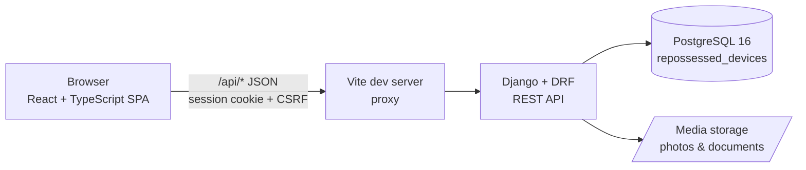
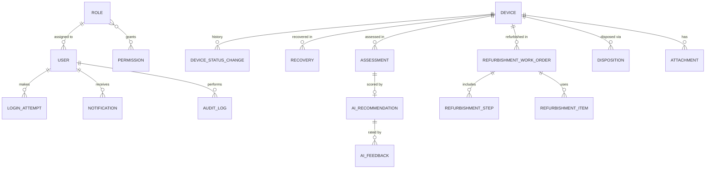
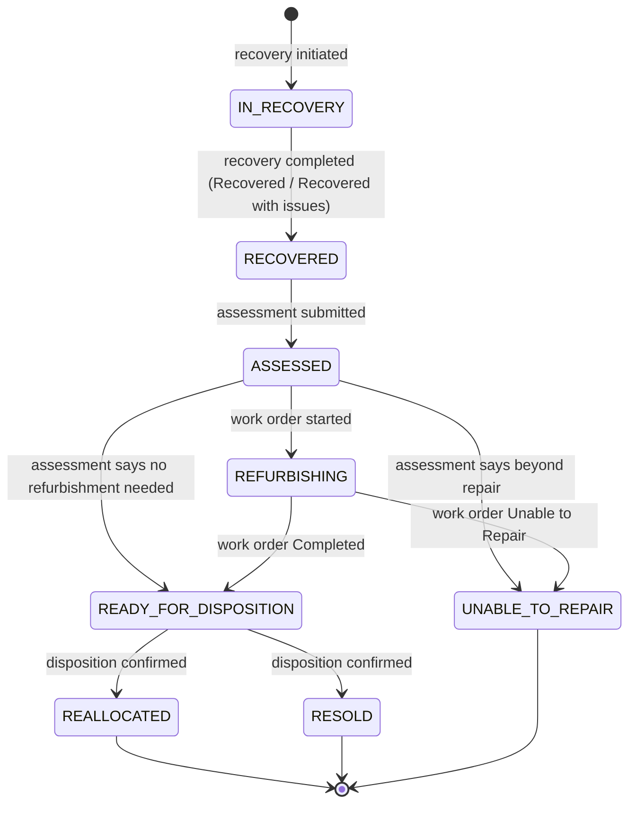

# Architecture

AI-Enhanced Repossessed Device Lifecycle Management System — academic prototype for Yellow (Rwanda).

The system tracks each repossessed device through
**Recovery → Condition Assessment → Refurbishment → Reallocation/Resale**, with role-based access control, a full audit trail, and rule-based AI decision support that only *recommends*.

Decisions marked **(Decision)** were not fixed by the specification; the simplest reasonable option was chosen.

---

## 1. System architecture

| Layer | Technology | Responsibility |
|---|---|---|
| Frontend | React 19, TypeScript, Vite, Tailwind CSS, Recharts, React Router | Screens, forms, role-aware navigation, charts. No business rules. |
| API | Django 5.2, Django REST Framework | Authentication, authorization, validation, business rules, audit. |
| Database | PostgreSQL 16 | Relational system of record. |
| File storage | Local filesystem (`MEDIA_ROOT`) | Evidence photos and documents. |

In development, Vite proxies `/api` to Django, so the browser sees one origin. Uploaded files are never served from a public `/media/` URL; they download through an authenticated API endpoint. CORS (`django-cors-headers`) is also configured for direct cross-origin access.

### Backend layout

Each Django app owns its models, serializers, views, URLs and tests:

| App | Owns |
|---|---|
| `accounts` | User, Role, Permission, LoginAttempt, login/logout, MFA, profile, user management |
| `devices` | Device, DeviceStatusChange, Attachment, the lifecycle state machine |
| `recovery` | Recovery records |
| `assessments` | Condition assessments |
| `refurbishment` | Work orders, steps, parts/materials |
| `dispositions` | Reallocation and resale records |
| `ai_engine` | Rule engine, AIRecommendation, feedback, reference prices |
| `notifications` | In-app notifications |
| `audit` | AuditLog and the audit-writing service |
| `analytics` | Read-only KPI and report queries (no models) |

**Business logic lives in service functions** (`<app>/services.py`), not in views or the frontend. Views authenticate, check permissions, validate input with serializers, and call a service. Services run inside a database transaction and:

1. check lifecycle rules,
2. write the domain record,
3. change device status (only through `devices.services.transition_device`),
4. write the audit log entry, and
5. create notifications.

This keeps every state change auditable and consistent no matter which endpoint triggered it.

---

## 2. Main entities

| Entity | Purpose |
|---|---|
| User | Internal staff account (one role each) |
| Role / Permission | RBAC: a role is a named set of permission codes |
| LoginAttempt | Every login attempt, successful or not |
| Device | Central record: one per physical device |
| DeviceStatusChange | Lifecycle history: every status transition |
| Recovery | How, when and where the device was repossessed |
| Assessment | Structured condition checklist (controlled choices), defects and RWF estimates; Draft → Submitted |
| RefurbishmentWorkOrder | Repair job (`REF-YYYY-NNNNN`) for a Refurbishing device: Open → In progress → Completed (repaired / unable to repair) or Cancelled |
| RefurbishmentStep | Work and checks on a work order (diagnosis, cleaning, screen repair, … functional test, quality check) with status and timestamps |
| RefurbishmentItem | Parts/materials used: quantity × unit cost (whole RWF) |
| Disposition | Final reallocation or resale (`DSP-YYYY-NNNNN`): Draft → Confirmed; buyer/recipient by pseudonymous reference only |
| AIRecommendation | The rule engine's recommendation for one submitted assessment, and (separately) the human final decision |
| AIFeedback | One staff member's verdict on a recommendation (would accept / would override) with an optional comment |
| ReferencePrice | *(planned, pricing phase)* Admin-maintained base price per make/model |
| Notification | In-app message to one user |
| AuditLog | Append-only record of every important action |
| Attachment | Photo or document linked to a device and optionally to a lifecycle record |

Full fields and constraints: [database-design.md](database-design.md).

## 3. Entity relationships

The Device is the hub. Lifecycle records hang off it and are never overwritten, so the full history of any device can be rebuilt from them.

---

## 4. Authentication

- **Internal staff only.** There is no public registration; a System Administrator creates accounts.
- **Login by email + password.** Passwords are hashed with Django's default PBKDF2-SHA256 and checked against minimum-length, common-password and similarity validators.
- **Server-side sessions.** On success Django sets an `HttpOnly`, `SameSite=Lax` session cookie that ends when the browser closes. Unsafe requests, including login and MFA verification, must carry the `X-CSRFToken` header. No tokens are kept in `localStorage`.
- **Session timeout.** `SessionTimeoutMiddleware` signs the user out after 30 idle minutes (`SESSION_IDLE_TIMEOUT`) or 8 hours after login (`SESSION_COOKIE_AGE`), and audits `SESSION_EXPIRED`.
- **TOTP MFA (`pyotp`).** Works with any authenticator app and runs fully offline:
  1. The user enrols from their profile. The server generates a secret and returns an `otpauth://` URI, shown as a QR code. Enrolment is confirmed by entering one valid code.
  2. At login, a correct password for an MFA-enabled user creates a *pending* session. Only a valid 6-digit code turns it into a full session.
  3. **(Decision)** MFA is optional per user. Making it mandatory for chosen roles (e.g. System Administrator) is a possible later addition.
  4. **(Decision)** The TOTP secret is stored Fernet-encrypted in the user row (`MFA_ENCRYPTION_KEY`, or a key derived from `DJANGO_SECRET_KEY`), shown only once during enrolment, and never logged. The last accepted time step is stored so a code cannot be used twice.
  5. The pending state expires after 5 minutes (`MFA_PENDING_TIMEOUT`). Wrong codes count towards the lockout below.
  6. An administrator can reset a user's MFA (lost phone) through `POST /api/users/{id}/reset-mfa/`.
- **Login attempt tracking.** Every attempt is stored in `LoginAttempt` (email, user, success, reason, IP, user agent). **(Decision)** After 5 consecutive failed passwords or MFA codes the account is locked for 15 minutes (`LOGIN_LOCKOUT_THRESHOLD`, `LOGIN_LOCKOUT_MINUTES`). A successful login or an administrator password reset clears the counter.
- **Account status.** `ACTIVE`, `SUSPENDED` or `DEACTIVATED`. Only active users can log in. Suspending a user ends their sessions.
- **Passwords.** Users change their own password (current password required; other sessions end). There is no email, so "reset" means a System Administrator sets a temporary password (`POST /api/users/{id}/reset-password/`), which also ends the user's sessions.
- **Role-based redirect.** After login, `/api/auth/me/` returns the user's role and permissions. The frontend sends each role to its own dashboard.

## 5. RBAC

**Model.** Each user has exactly one Role. A Role holds a set of Permission codes such as `device.create` or `ai.override`. Admins can view roles and change which permissions each one grants.

**Backend enforcement (authoritative).**

- DRF default: every endpoint requires an authenticated user. Only login, CSRF and health endpoints opt out.
- Each view declares the permission codes it needs with `require_permission(Perm.X)` (`accounts/permissions.py`). Missing permission → **403**; not logged in → **401**.
- Object-level checks where the spec needs them. **(Decision)** Lifecycle records are team work: any holder of the module's permission may manage any open record (e.g. any `refurbishment.manage` user may work on any active work order; the assignee is recorded but not enforced).
- Querysets are filtered by role where appropriate, so list endpoints never leak records the user may not see.

**Frontend enforcement (convenience only).** Navigation items, routes and action buttons are hidden unless the user's permission list contains the required code. Calling an API directly still hits the backend checks.

### Default permission matrix

| Permission | Recovery Officer | Device Assessor | Refurb. Staff | Sales Officer | Ops Manager | System Admin |
|---|:-:|:-:|:-:|:-:|:-:|:-:|
| `device.view` | ✓ | ✓ | ✓ | ✓ | ✓ | ✓ |
| `device.create` | ✓ | | | | | |
| `device.update` | ✓ | | | | ✓ | |
| `recovery.manage` | ✓ | | | | | |
| `assessment.create` | | ✓ | | | | |
| `refurbishment.manage` | | | ✓ | | | |
| `disposition.create` | | | | ✓ | | |
| `ai.request` | | ✓ | ✓ | ✓ | ✓ | |
| `ai.view` | | ✓ | ✓ | ✓ | ✓ | |
| `ai.decide` (accept/override) | | | | | ✓ | |
| `ai.feedback` | | ✓ | ✓ | ✓ | ✓ | |
| `analytics.view` | | | | | ✓ | ✓ |
| `user.manage` / `role.manage` | | | | | | ✓ |
| `audit.view` | | | | | | ✓ |
| `config.manage` (reference prices, settings) | | | | | | ✓ |

**(Decision, Phase 8)** Only the Reallocation/Sales Officer holds `disposition.create`, so only that role drafts and confirms dispositions; the Operations Manager and other roles see them read-only (`device.view`). An administrator can grant `disposition.create` to another role through role management.

Every role can view and edit its own profile and read its own notifications. **(Decision)** The System Administrator manages the system but does not perform lifecycle operations, which keeps duties separate.

---

## 6. Device lifecycle

The device's `status` is the single source of truth. The *lifecycle stage* shown in the UI is derived from it rather than stored separately.

| Status | Stage |
|---|---|
| `IN_RECOVERY`, `RECOVERED` | Recovery |
| `ASSESSED` | Condition Assessment |
| `REFURBISHING` | Refurbishment |
| `READY_FOR_DISPOSITION` | Reallocation/Resale |
| `REALLOCATED`, `RESOLD` | Closed |
| `UNABLE_TO_REPAIR` | Exception (closed) |

**Registration.** `devices.services.register_device` creates a device in `IN_RECOVERY` (recovery under way) or `RECOVERED` (already in hand) and writes the first `DeviceStatusChange` (from: none). The status cannot be set or edited through the device API.

**Recovery (Phase 5).** `recovery.services` owns the `IN_RECOVERY → RECOVERED` step:

1. A Recovery Officer opens a recovery record (`IN_PROGRESS`) for a device that is `IN_RECOVERY` and has no other open recovery. It stays editable and can collect evidence files.
2. **Complete** locks the record. The outcome, location, and (for *Recovered with issues* / *Not recovered*) notes are required.
   - *Recovered* or *Recovered with issues*: in the same transaction the service calls `transition_device(device, RECOVERED, source_type="recovery", source_id=<recovery id>)`, which writes the `DeviceStatusChange` and audit entry.
   - *Not recovered*: the attempt is closed as history and the device stays `IN_RECOVERY`; a new attempt can be recorded.
3. A completed recovery cannot be edited, completed again or given new evidence (service checks plus a PostgreSQL trigger).

**(Decision)** The original specification listed recovery statuses *Initiated / In Transit / Received*. The prototype uses a record status (*In progress → Completed*) plus an outcome instead: *In progress* covers initiated and in transit, and completing with a successful outcome is the point of receipt. Devices registered directly as `RECOVERED` (already in hand) have no recovery record.

**Condition assessment and final decision (Phase 6).** `assessments.services` and `ai_engine.services` own the next steps:

1. A Device Assessor starts a **Draft** assessment for a `RECOVERED` device (one draft per device). Every field may be filled in gradually; evidence files can be attached while it is a draft.
2. **Submit** requires all six condition choices plus the estimated repair cost and a market value above 0 RWF. In one transaction the assessment becomes **Submitted** (immutable), `transition_device(device, ASSESSED, source_type="assessment", source_id=<assessment id>)` runs with the reason "Condition assessment ASS-… submitted.", and the device's condition rating is set from the physical condition (`CRITICAL` maps to `POOR`) through `devices.services.record_condition` (audited).
3. A user with `ai.request` asks for the **AI recommendation**. It is stored, audited and shown, and **does not touch the device**.
4. An Operations Manager (`ai.decide`) records the **final decision**: accept the recommendation or override it with a reason. The *human* decision moves the device `ASSESSED → REFURBISHING / READY_FOR_DISPOSITION / UNABLE_TO_REPAIR` via `transition_device(..., source_type="assessment_decision")`. Refurbishment work orders (Phase 7) and dispositions (Phase 8) follow below.

Only one submitted assessment can exist per device (partial unique index). The lifecycle has no path back to `RECOVERED`, so re-assessment is not possible yet; if it is added, the earlier assessment stays as history.

**Refurbishment (Phase 7).** `refurbishment.services` owns the exits from `REFURBISHING`:

1. Refurbishment staff (`refurbishment.manage`) open a **work order** for a `REFURBISHING` device (one active work order per device; partial unique index). It is planned while **Open** (assignee, diagnosis, estimated cost, steps, parts) and **started** (`In progress`, `started_at`; unassigned work goes to whoever starts it).
2. **Steps** move `Pending → In progress → Completed`, or to `Skipped` with a reason. Progress needs a started work order; completed and skipped steps are final.
3. **Parts** record quantity × unit cost; the server calculates each line total and the parts total.
4. **Complete** (repaired) requires a work summary, the labour cost, every step completed or skipped with a reason, and a completed **Functional test** and **Quality check** (they cannot be skipped). The actual cost = parts total + labour is calculated and frozen. In one transaction (work order and device rows locked) the work order becomes Completed/Repaired and `transition_device(device, READY_FOR_DISPOSITION, source_type="refurbishment", source_id=<work order id>)` runs.
5. **Unable to repair** requires a reason; the work order becomes Completed/Unable to repair (actual cost = parts used + any labour) and the device moves `REFURBISHING → UNABLE_TO_REPAIR` the same way.
6. **Cancel** (reason required) closes a work order opened in error without changing the device, which stays `REFURBISHING` for a new work order.

Closed work orders, their steps and parts are history: service checks plus PostgreSQL triggers reject changes and deletes. The AI never creates, starts or completes a work order.

**Reallocation and resale (Phase 8).** `dispositions.services` owns the final step:

1. A Reallocation/Sales Officer (`disposition.create`) drafts a **disposition** for a `READY_FOR_DISPOSITION` device (one draft per device). Type **Reallocation** needs a destination (department, branch or partner) and optionally a recipient reference; type **Resale** needs a sale price (> 0, whole RWF) and a buyer reference. Fields of the other type are rejected; switching type clears the old type's fields. Buyers and recipients are recorded only by pseudonymous reference (letters, digits, `-`, `_`, `/`; no spaces), never by name or ID number.
2. The draft can be edited and given evidence (receipt, handover form). It never changes the device.
3. **Confirm** (signed-in, active human only) locks the disposition row; in one transaction it becomes `CONFIRMED` and `transition_device(device, REALLOCATED or RESOLD, source_type="disposition", source_id=<id>)` runs.
4. At most one confirmed disposition per device (partial unique index). Confirmed dispositions are immutable and no disposition can be deleted (PostgreSQL trigger). No AI code path creates or confirms a disposition.

**Rules enforced in `transition_device`** (implemented in the Device Management phase):

- Only the transitions above are allowed; unknown statuses and anything else raise `InvalidTransition`, which a view returns as **400** with a reason.
- The device row is locked (`SELECT … FOR UPDATE`), and the status update, `DeviceStatusChange` row (from, to, who, when, reason, source type/id) and `AuditLog` entry are written in one transaction.
- A signed-in, active staff member must be the actor, and `source_type` `ai_recommendation`/`ai_engine` is refused: **AI never changes a device's status.**
- `DeviceStatusChange` is append-only: model guards plus a PostgreSQL trigger reject `UPDATE`/`DELETE`, and devices with history cannot be deleted (`PROTECT`).

Enforced by the lifecycle services (not by `transition_device` itself, which only checks the transition table):

- `READY_FOR_DISPOSITION` is reached only through a human final decision on a submitted assessment (Phase 6) or a completed, repaired work order (Phase 7).

- A device is disposed of (`REALLOCATED`/`RESOLD`) only by confirming a disposition while it is `READY_FOR_DISPOSITION`, and it can have only one confirmed disposition (Phase 8).

**Device identification.** Each device gets a `device_code` (`YRW-<year>-<number>`) from a PostgreSQL sequence, so concurrent registrations never collide. A device needs an IMEI (15 digits, Luhn-checked) or a serial number (stored upper-case, compared case-insensitively); both are unique when present. The previous owner is stored only as a pseudonymous Yellow account reference (letters, digits, `-_/`, no spaces), which keeps names and national IDs out.

**Device API permissions.** `device.view`: list, detail, history, attachment list and download. `device.create`: register. `device.update`: edit and upload attachments.

**Exception states (Decision).** *Damaged* and *non-functional* are recorded as assessment findings (functionality, physical condition, damage notes) and reflected in the device's current condition. They lead to either refurbishment or `UNABLE_TO_REPAIR`, so they don't need separate statuses. `UNABLE_TO_REPAIR` is terminal in this prototype.

## 7. AI decision support

> The current AI component is an explainable rule-based decision-support engine. Future versions could replace or augment it with a trained machine-learning model when sufficient historical device lifecycle data is available.

The engine lives in `backend/ai_engine/rules.py`. It is deterministic and versioned (`RULE_VERSION = "rules-v1.0"`): the same assessment always produces the same recommendation, score, confidence and reasons. Every weight and threshold is a named constant in that one module; changing any of them means bumping the version, which is stored with each recommendation. The UI labels the output "AI recommendation — human decision required" and "Explainable rule-based · not machine learning".

**Input:** the submitted assessment (functionality, physical, screen, battery, cosmetic, accessories, defects, estimated repair cost and market value in RWF).

**Score (0–100)** — points per finding, summed and clamped to 0–100:

| Factor | Points |
|---|---|
| Functionality | Fully 30 · Partially 15 · Non-functional 0 |
| Physical condition | Excellent 20 · Good 16 · Fair 10 · Poor 4 · Critical 0 |
| Screen | Intact 15 · Minor damage 10 · Major damage 4 · Broken 0 |
| Battery | Excellent 15 · Good 12 · Fair 7 · Poor 3 · Failed 0 |
| Cosmetic condition | Excellent 10 · Good 8 · Fair 5 · Poor 2 |
| Accessories | Complete 5 · Partial 3 · None 0 |
| Repair economics | repair cost ≤ 25% of value: 5 · ≤ 50%: 2 · otherwise 0 |
| Defects | −3 per recorded defect, at most −15 |

A perfect device scores 100.

**Recommendation** — rules applied in order; the first that matches wins:

1. Physical condition *Critical* → **Unable to repair** (confidence 95%).
2. Repair cost > 60% of market value → **Unable to repair** (uneconomic).
3. *Non-functional* and score < 35 → **Unable to repair**.
4. Fully functional, nothing needing repair (screen not major/broken, battery not poor/failed, no defects, repair cost ≤ 10% of value) and score ≥ 75 → **Ready for disposition**.
5. Otherwise → **Refurbish** (repairable issues at an economic cost, or a working device scoring below 75).

**Confidence** expresses how far the inputs are from the nearest threshold that would change the recommendation: `0.60 + 1.5 × margin`, clamped to 55–95%. It is a rule-based certainty indicator, **not a statistical probability**, and the UI says so.

**Reasons** list each finding in plain language (e.g. "Estimated repair cost is 18,000 RWF; estimated market value is 85,000 RWF (21% of value).") and end with the rule that decided (e.g. "Rule: the device has repairable issues and the repair cost is within 60% of the market value…"). A collapsible table shows the points per factor.

Worked example (from the brief): partially functional, good physical and cosmetic condition, major screen damage, fair battery, partial accessories, repair 18,000 RWF, value 85,000 RWF → score 58, **Refurbish** (rule 5), confidence 95%.

**Recommendation vs human decision**

- `AIRecommendation` stores the AI output (recommendation, score, confidence, reasons, factor points, rule, rule version, who requested it, when) and, in **separate** fields, the human final decision (decision, by, at, reason). An override never overwrites the AI output.
- One recommendation per submitted assessment. Requesting again returns the existing one (201 first time, then 200), because the input is immutable and the rules deterministic.
- Only `ai.decide` (Operations Manager) can decide; a reason is required when the decision differs from the recommendation. The decision is write-once.
- A PostgreSQL trigger makes the AI columns immutable, allows the decision columns to be filled only once, and blocks deletes. CHECK constraints require who/when for every decision and a reason for every override.
- **Feedback:** users with `ai.feedback` record whether they would *accept* or *override* the recommendation, with an optional comment (one per user, append-only). This, together with the decision outcome (accepted/overridden), is the basis for AI-effectiveness reporting in the analytics phase.

**Limitations.** The weights and thresholds are reasoned defaults, not fitted to Yellow data; market value and repair cost are the assessor's estimates; confidence is not a probability. Pricing and reallocation-channel recommendations (and `ReferencePrice`) are not implemented: dispositions (Phase 8) record the human-chosen price and destination, and AI pricing remains future work.

**Future machine learning.** Each `AIRecommendation` stores its inputs (via the immutable assessment), the AI output, the human decision and feedback. Once enough devices have completed their lifecycle, this history (with refurbishment costs and sale prices from later phases) is a labelled dataset from which a model could be trained, evaluated against the rule engine, and introduced behind the same API with a new `rule_version`/model identifier, keeping human decisions in control.

## 8. Audit

- `AuditLog` is **append-only**. No API updates or deletes it, the Django admin shows it read-only, the model and queryset refuse changes, and a PostgreSQL trigger (`audit` migration 0002) rejects `UPDATE`/`DELETE` from any client. The only allowed update is `ON DELETE SET NULL` of the user link; `user_label` keeps the email.
- Entries are written by `audit.services.log_action(...)` from inside the same service transaction as the change, so an action and its audit record succeed or fail together. Login, logout, failed logins and lockouts are logged by `accounts.services` and the auth views. Login attempts are also listed at `GET /api/login-attempts/` (`audit.view`).
- Each entry records: user, action, entity type, entity ID, timestamp, previous values and new values (JSON, changed fields only), IP address, user agent, and a short description.
- Passwords, MFA secrets and session data are never written to the log.
- Admins browse it at `/admin/audit-log` with filters for user, action, entity, entity ID and date range.

Audited actions: login / logout / failed login / lockout / unlock / session expiry, password change / reset, MFA setup / enable / disable / verify / failure, user and role changes, device created / updated / status changed, recovery recorded / updated / completed (`RECOVERY_CREATED`, `RECOVERY_UPDATED`, `RECOVERY_COMPLETED`), assessment created / updated / submitted (`ASSESSMENT_CREATED`, `ASSESSMENT_UPDATED`, `ASSESSMENT_SUBMITTED`), device condition set from an assessment (`DEVICE_UPDATED`), AI recommendation generated (`AI_RECOMMENDATION_GENERATED`), final decision accepted / overridden with reason (`AI_DECISION_MADE`), AI feedback (`AI_FEEDBACK_RECORDED`), work order created / updated / started / completed / unable to repair / cancelled (`REFURBISHMENT_CREATED`, `REFURBISHMENT_UPDATED`, `REFURBISHMENT_STARTED`, `REFURBISHMENT_COMPLETED`, `REFURBISHMENT_UNABLE_TO_REPAIR`, `REFURBISHMENT_CANCELLED`), refurbishment steps and parts added / updated (`REFURBISHMENT_STEP_CREATED`, `REFURBISHMENT_STEP_UPDATED`, `REFURBISHMENT_ITEM_CREATED`, `REFURBISHMENT_ITEM_UPDATED`), disposition drafted / updated / confirmed (`DISPOSITION_CREATED`, `DISPOSITION_UPDATED`, `DISPOSITION_CONFIRMED`; confirmation also writes `DEVICE_STATUS_CHANGED`), attachment uploaded (`ATTACHMENT_UPLOADED`, with the linked record's reference). Reference-price changes are audited when pricing is built.

## 9. API structure

REST, JSON, all under `/api/`. Lists are paginated (`?page=`, 20 per page) and accept search/filter query parameters. Errors return a JSON body with `detail` or per-field messages and a meaningful status: 400 validation/lifecycle rule, 401/403 auth, 404, 409 conflict.

| Area | Endpoints |
|---|---|
| Health | `GET /api/health/` |
| Auth | `GET /api/auth/csrf/` · `POST /api/auth/login/` · `POST /api/auth/mfa/verify/` · `POST /api/auth/logout/` · `GET/PATCH /api/auth/me/` · `POST /api/auth/change-password/` · `POST /api/auth/mfa/setup/`, `/mfa/confirm/`, `/mfa/disable/` |
| Users & roles | `GET/POST /api/users/` · `GET/PATCH /api/users/{id}/` · `POST /api/users/{id}/reset-password/` · `POST /api/users/{id}/reset-mfa/` · `POST /api/users/{id}/unlock/` · `GET /api/roles/` · `PATCH /api/roles/{id}/` · `GET /api/permissions/` · `GET /api/login-attempts/` |
| Devices | `GET/POST /api/devices/` (`?search=&status=&make=&model=&device_type=&condition=&recovered_from=&recovered_to=&page=`) · `GET/PATCH /api/devices/{id}/` · `GET /api/devices/{id}/history/` · `GET/POST /api/devices/{id}/attachments/` · `GET /api/devices/{id}/attachments/{attachment_id}/download/` |
| Recovery | `GET/POST /api/recoveries/` (`?device=&status=&outcome=&search=&page=`) · `GET/PATCH /api/recoveries/{id}/` (PATCH only while In progress) · `POST /api/recoveries/{id}/complete/` · `GET/POST /api/recoveries/{id}/attachments/`. Read: `device.view`; write: `recovery.manage`. |
| Assessments | `GET/POST /api/assessments/` (`?device=&status=&search=&page=`) · `GET/PATCH /api/assessments/{id}/` (PATCH only while Draft) · `POST /api/assessments/{id}/submit/` · `GET/POST /api/assessments/{id}/attachments/`. Read: `device.view`; write: `assessment.create`. |
| Refurbishment | `GET/POST /api/refurbishments/` (`?device=&status=OPEN\|IN_PROGRESS\|COMPLETED\|CANCELLED\|ACTIVE&assigned_to=<id>\|me&search=&page=`) · `GET/PATCH /api/refurbishments/{id}/` (PATCH only while active) · `POST /api/refurbishments/{id}/start/` · `POST /api/refurbishments/{id}/complete/` (`work_summary`, `labour_cost_rwf`) · `POST /api/refurbishments/{id}/unable-to-repair/` (`reason`) · `POST /api/refurbishments/{id}/cancel/` (`reason`) · `GET/POST /api/refurbishments/{id}/steps/` · `PATCH /api/refurbishment-steps/{id}/` · `GET/POST /api/refurbishments/{id}/items/` · `PATCH /api/refurbishment-items/{id}/` · `GET/POST /api/refurbishments/{id}/attachments/` · `GET /api/refurbishments/technicians/`. Read: `device.view`; write: `refurbishment.manage`. |
| Dispositions | `GET/POST /api/dispositions/` (`?device=&type=REALLOCATION\|RESALE&status=DRAFT\|CONFIRMED&search=&date_from=&date_to=&page=`) · `GET/PATCH /api/dispositions/{id}/` (PATCH only while Draft) · `POST /api/dispositions/{id}/confirm/` · `GET/POST /api/dispositions/{id}/attachments/`. Read: `device.view`; write: `disposition.create`. |
| AI | `GET /api/assessments/{id}/ai-recommendation/` (`ai.view`) · `POST /api/assessments/{id}/ai-recommendation/` (`ai.request`) · `POST /api/assessments/{id}/decision/` (`ai.decide`; body `final_decision`, `reason`) · `POST /api/assessments/{id}/ai-feedback/` (`ai.feedback`; body `verdict`, `comment`) · `GET /api/ai-recommendations/` (`ai.view`; `?decision=pending\|decided&recommendation=&outcome=ACCEPTED\|OVERRIDDEN&search=`). Pricing/channel recommendations are future work. |
| Notifications | `GET /api/notifications/` · `GET /api/notifications/unread-count/` · `POST /api/notifications/{id}/read/` · `POST /api/notifications/read-all/` · `POST /api/notifications/announcements/` (admin) |
| Dashboards & analytics | `GET /api/dashboard/` (content depends on role) · `GET /api/analytics/summary/` · `GET /api/analytics/lifecycle/` · `GET /api/analytics/financials/` · `GET /api/analytics/ai-effectiveness/` · `GET /api/analytics/export/?format=csv` |
| Audit | `GET /api/audit-logs/` (`?user=&action=&entity_type=&entity_id=&from=&to=`) |

## 10. Other decisions

| Topic | Decision |
|---|---|
| Currency | All money is stored as whole RWF (`BIGINT`). RWF has no minor unit in practice. |
| Time zone | `Africa/Kigali`. Timestamps are stored in UTC. |
| Notifications | In-app only, stored in the database. The frontend polls the unread count every 30 s. No WebSockets, email or SMS. |
| Uploads | JPEG/PNG/WebP/PDF only, detected from the file signature (the browser's Content-Type is ignored) and matched against the extension. 5 MB maximum (`MAX_UPLOAD_SIZE_MB`). Stored as `attachments/YYYY/MM/<random>.<ext>`; the path is never returned. Downloads go through `GET /api/devices/{id}/attachments/{attachment_id}/download/` (`device.view`), served inline with `Content-Security-Policy: sandbox`. |
| Previous owner | Stored only as a pseudonymous customer reference (e.g. a Yellow account number), never name or national ID. |
| Report export | CSV export of analytics tables. PDF only if time allows. |
| Secrets | Only in environment variables (`.env`, git-ignored). `.env.example` documents them. |
