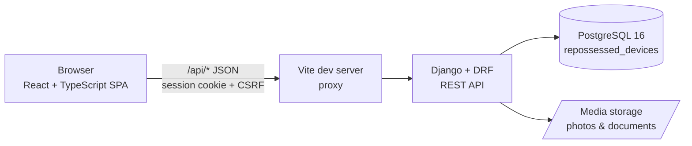
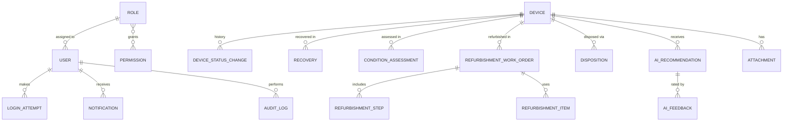
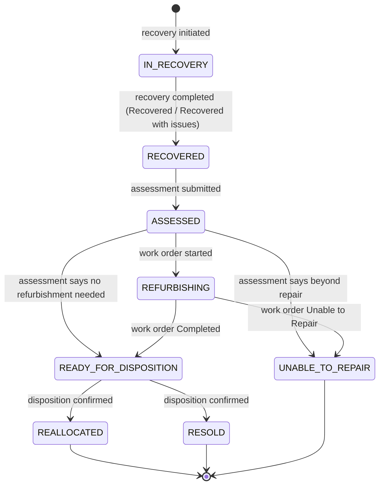

# Architecture

AI-Enhanced Repossessed Device Lifecycle Management System — academic prototype for Yellow (Rwanda).

The system tracks each repossessed device through
**Recovery → Condition Assessment → Refurbishment → Reallocation/Resale**, with role-based access control, a full audit trail, and rule-based AI decision support that only *recommends*.

Decisions marked **(Decision)** were not fixed by the specification; the simplest reasonable option was chosen.

---

## 1. System architecture

| Layer | Technology | Responsibility |
|---|---|---|
| Frontend | React 19, TypeScript, Vite, Tailwind CSS, Recharts, React Router | Screens, forms, role-aware navigation, charts. No business rules. |
| API | Django 5.2, Django REST Framework | Authentication, authorization, validation, business rules, audit. |
| Database | PostgreSQL 16 | Relational system of record. |
| File storage | Local filesystem (`MEDIA_ROOT`) | Evidence photos and documents. |

In development, Vite proxies `/api` to Django, so the browser sees one origin. Uploaded files are never served from a public `/media/` URL; they download through an authenticated API endpoint. CORS (`django-cors-headers`) is also configured for direct cross-origin access.

### Backend layout

Each Django app owns its models, serializers, views, URLs and tests:

| App | Owns |
|---|---|
| `accounts` | User, Role, Permission, LoginAttempt, login/logout, MFA, profile, user management |
| `devices` | Device, DeviceStatusChange, Attachment, the lifecycle state machine |
| `recovery` | Recovery records |
| `assessments` | Condition assessments |
| `refurbishment` | Work orders, steps, parts/materials |
| `dispositions` | Reallocation and resale records |
| `ai_engine` | Rule engine, AIRecommendation, feedback, reference prices |
| `notifications` | In-app notifications |
| `audit` | AuditLog and the audit-writing service |
| `analytics` | Read-only KPI and report queries (no models) |

**Business logic lives in service functions** (`<app>/services.py`), not in views or the frontend. Views authenticate, check permissions, validate input with serializers, and call a service. Services run inside a database transaction and:

1. check lifecycle rules,
2. write the domain record,
3. change device status (only through `devices.services.transition_device`),
4. write the audit log entry, and
5. create notifications.

This keeps every state change auditable and consistent no matter which endpoint triggered it.

---

## 2. Main entities

| Entity | Purpose |
|---|---|
| User | Internal staff account (one role each) |
| Role / Permission | RBAC: a role is a named set of permission codes |
| LoginAttempt | Every login attempt, successful or not |
| Device | Central record: one per physical device |
| DeviceStatusChange | Lifecycle history: every status transition |
| Recovery | How, when and where the device was repossessed |
| ConditionAssessment | Structured checklist, rating and recommended action |
| RefurbishmentWorkOrder | Repair job assigned to a technician |
| RefurbishmentStep | Steps carried out (cleaning, parts replacement, software reset…) |
| RefurbishmentItem | Parts/materials used, with cost |
| Disposition | Final reallocation or resale |
| AIRecommendation | One AI suggestion, its inputs, output, confidence, explanation and human decision |
| AIFeedback | Helpful / Not helpful rating on a recommendation |
| ReferencePrice | Admin-maintained base price per make/model (pricing fallback) |
| Notification | In-app message to one user |
| AuditLog | Append-only record of every important action |
| Attachment | Photo or document linked to a device and optionally to a lifecycle record |

Full fields and constraints: [database-design.md](database-design.md).

## 3. Entity relationships

The Device is the hub. Lifecycle records hang off it and are never overwritten, so the full history of any device can be rebuilt from them.

---

## 4. Authentication

- **Internal staff only.** There is no public registration; a System Administrator creates accounts.
- **Login by email + password.** Passwords are hashed with Django's default PBKDF2-SHA256 and checked against minimum-length, common-password and similarity validators.
- **Server-side sessions.** On success Django sets an `HttpOnly`, `SameSite=Lax` session cookie that ends when the browser closes. Unsafe requests, including login and MFA verification, must carry the `X-CSRFToken` header. No tokens are kept in `localStorage`.
- **Session timeout.** `SessionTimeoutMiddleware` signs the user out after 30 idle minutes (`SESSION_IDLE_TIMEOUT`) or 8 hours after login (`SESSION_COOKIE_AGE`), and audits `SESSION_EXPIRED`.
- **TOTP MFA (`pyotp`).** Works with any authenticator app and runs fully offline:
  1. The user enrols from their profile. The server generates a secret and returns an `otpauth://` URI, shown as a QR code. Enrolment is confirmed by entering one valid code.
  2. At login, a correct password for an MFA-enabled user creates a *pending* session. Only a valid 6-digit code turns it into a full session.
  3. **(Decision)** MFA is optional per user. Making it mandatory for chosen roles (e.g. System Administrator) is a possible later addition.
  4. **(Decision)** The TOTP secret is stored Fernet-encrypted in the user row (`MFA_ENCRYPTION_KEY`, or a key derived from `DJANGO_SECRET_KEY`), shown only once during enrolment, and never logged. The last accepted time step is stored so a code cannot be used twice.
  5. The pending state expires after 5 minutes (`MFA_PENDING_TIMEOUT`). Wrong codes count towards the lockout below.
  6. An administrator can reset a user's MFA (lost phone) through `POST /api/users/{id}/reset-mfa/`.
- **Login attempt tracking.** Every attempt is stored in `LoginAttempt` (email, user, success, reason, IP, user agent). **(Decision)** After 5 consecutive failed passwords or MFA codes the account is locked for 15 minutes (`LOGIN_LOCKOUT_THRESHOLD`, `LOGIN_LOCKOUT_MINUTES`). A successful login or an administrator password reset clears the counter.
- **Account status.** `ACTIVE`, `SUSPENDED` or `DEACTIVATED`. Only active users can log in. Suspending a user ends their sessions.
- **Passwords.** Users change their own password (current password required; other sessions end). There is no email, so "reset" means a System Administrator sets a temporary password (`POST /api/users/{id}/reset-password/`), which also ends the user's sessions.
- **Role-based redirect.** After login, `/api/auth/me/` returns the user's role and permissions. The frontend sends each role to its own dashboard.

## 5. RBAC

**Model.** Each user has exactly one Role. A Role holds a set of Permission codes such as `device.create` or `ai.override`. Admins can view roles and change which permissions each one grants.

**Backend enforcement (authoritative).**

- DRF default: every endpoint requires an authenticated user. Only login, CSRF and health endpoints opt out.
- Each view declares the permission codes it needs with `require_permission(Perm.X)` (`accounts/permissions.py`). Missing permission → **403**; not logged in → **401**.
- Object-level checks where the spec needs them. For example, Refurbishment Staff may update only work orders assigned to them.
- Querysets are filtered by role where appropriate, so list endpoints never leak records the user may not see.

**Frontend enforcement (convenience only).** Navigation items, routes and action buttons are hidden unless the user's permission list contains the required code. Calling an API directly still hits the backend checks.

### Default permission matrix

| Permission | Recovery Officer | Device Assessor | Refurb. Staff | Sales Officer | Ops Manager | System Admin |
|---|:-:|:-:|:-:|:-:|:-:|:-:|
| `device.view` | ✓ | ✓ | ✓ | ✓ | ✓ | ✓ |
| `device.create` | ✓ | | | | | |
| `device.update` | ✓ | | | | ✓ | |
| `recovery.manage` | ✓ | | | | | |
| `assessment.create` | | ✓ | | | | |
| `refurbishment.manage` | | | ✓ | | | |
| `disposition.create` | | | | ✓ | | |
| `ai.request` | | ✓ | ✓ | ✓ | ✓ | |
| `ai.view` | | ✓ | ✓ | ✓ | ✓ | |
| `ai.decide` (accept/override) | | | | | ✓ | |
| `ai.feedback` | | ✓ | ✓ | ✓ | ✓ | |
| `analytics.view` | | | | | ✓ | ✓ |
| `user.manage` / `role.manage` | | | | | | ✓ |
| `audit.view` | | | | | | ✓ |
| `config.manage` (reference prices, settings) | | | | | | ✓ |

Every role can view and edit its own profile and read its own notifications. **(Decision)** The System Administrator manages the system but does not perform lifecycle operations, which keeps duties separate.

---

## 6. Device lifecycle

The device's `status` is the single source of truth. The *lifecycle stage* shown in the UI is derived from it rather than stored separately.

| Status | Stage |
|---|---|
| `IN_RECOVERY`, `RECOVERED` | Recovery |
| `ASSESSED` | Condition Assessment |
| `REFURBISHING` | Refurbishment |
| `READY_FOR_DISPOSITION` | Reallocation/Resale |
| `REALLOCATED`, `RESOLD` | Closed |
| `UNABLE_TO_REPAIR` | Exception (closed) |

**Registration.** `devices.services.register_device` creates a device in `IN_RECOVERY` (recovery under way) or `RECOVERED` (already in hand) and writes the first `DeviceStatusChange` (from: none). The status cannot be set or edited through the device API.

**Recovery (Phase 5).** `recovery.services` owns the `IN_RECOVERY → RECOVERED` step:

1. A Recovery Officer opens a recovery record (`IN_PROGRESS`) for a device that is `IN_RECOVERY` and has no other open recovery. It stays editable and can collect evidence files.
2. **Complete** locks the record. The outcome, location, and (for *Recovered with issues* / *Not recovered*) notes are required.
   - *Recovered* or *Recovered with issues*: in the same transaction the service calls `transition_device(device, RECOVERED, source_type="recovery", source_id=<recovery id>)`, which writes the `DeviceStatusChange` and audit entry.
   - *Not recovered*: the attempt is closed as history and the device stays `IN_RECOVERY`; a new attempt can be recorded.
3. A completed recovery cannot be edited, completed again or given new evidence (service checks plus a PostgreSQL trigger).

**(Decision)** The original specification listed recovery statuses *Initiated / In Transit / Received*. The prototype uses a record status (*In progress → Completed*) plus an outcome instead: *In progress* covers initiated and in transit, and completing with a successful outcome is the point of receipt. Devices registered directly as `RECOVERED` (already in hand) have no recovery record.

**Rules enforced in `transition_device`** (implemented in the Device Management phase):

- Only the transitions above are allowed; unknown statuses and anything else raise `InvalidTransition`, which a view returns as **400** with a reason.
- The device row is locked (`SELECT … FOR UPDATE`), and the status update, `DeviceStatusChange` row (from, to, who, when, reason, source type/id) and `AuditLog` entry are written in one transaction.
- A signed-in, active staff member must be the actor, and `source_type` `ai_recommendation`/`ai_engine` is refused: **AI never changes a device's status.**
- `DeviceStatusChange` is append-only: model guards plus a PostgreSQL trigger reject `UPDATE`/`DELETE`, and devices with history cannot be deleted (`PROTECT`).

Added by later lifecycle phases (not yet enforced):

- A device cannot reach `READY_FOR_DISPOSITION` unless it has a submitted assessment, plus a completed work order if that assessment recommended refurbishment.
- A device cannot be disposed of unless it is `READY_FOR_DISPOSITION`, and it can have only one confirmed disposition.

**Device identification.** Each device gets a `device_code` (`YRW-<year>-<number>`) from a PostgreSQL sequence, so concurrent registrations never collide. A device needs an IMEI (15 digits, Luhn-checked) or a serial number (stored upper-case, compared case-insensitively); both are unique when present. The previous owner is stored only as a pseudonymous Yellow account reference (letters, digits, `-_/`, no spaces), which keeps names and national IDs out.

**Device API permissions.** `device.view`: list, detail, history, attachment list and download. `device.create`: register. `device.update`: edit and upload attachments.

**Exception states (Decision).** *Damaged* and *non-functional* are recorded as assessment findings (functionality, physical condition, damage notes) and reflected in the device's current condition. They lead to either refurbishment or `UNABLE_TO_REPAIR`, so they don't need separate statuses. `UNABLE_TO_REPAIR` is terminal in this prototype.

## 7. AI decision support

A **transparent, rule-based prototype decision-support engine**. No machine-learning model is trained, because there is no real training dataset. The UI and API label it "Prototype rule-based recommendation".

**Recommendation types**

1. **Condition** (requested during assessment): suggested rating Excellent/Good/Fair/Poor and a recommended action (no refurbishment / refurbish / unable to repair).
2. **Pricing & channel** (requested once refurbishment is complete, or straight after assessment if none is needed): a suggested price in RWF and a suggested route (resale via direct/online/dealer, or reallocation to internal/partner use).

**How it works**

- *Condition score (0–100):* weighted points from physical condition, functionality, screen and battery condition, minus deductions for recorded damage. Score bands map to ratings (≥85 Excellent, ≥65 Good, ≥40 Fair, otherwise Poor).
- *Price:* if at least 3 confirmed resales exist for the same make/model, the base price is their median sale price. Otherwise it is the admin-maintained `ReferencePrice`. The base is multiplied by a condition factor.
- *Channel:* compares expected price with refurbishment cost already spent. Low expected margin or poor condition points towards reallocation or dealer sale; good condition with healthy margin points towards direct/online resale.
- *Confidence (%):* how complete the inputs are, how far the score sits from a band boundary, and whether historical sales or only the reference price backed the estimate.
- *Explanation:* the factors that drove the result, in plain language, e.g. "Functional, minor scratches, battery fair; refurbishment cost 18,000 RWF is low relative to the expected price."
- Weights, thresholds and multipliers live in one versioned rules module (`rule_version` is stored on each recommendation), so results can be reproduced.

**Human control**

- A recommendation is stored with `decision = PENDING` and **changes nothing on the device**.
- The assessor can adopt or change the suggested condition when submitting their own assessment. The submitted assessment is the human decision of record.
- The Operations Manager **accepts** or **overrides** pricing/channel recommendations. An override requires the chosen values and a written justification. Both actions are audited.
- Any user who can view recommendations can mark them Helpful / Not Helpful.
- **Effectiveness metrics:** acceptance vs override rate, helpful rate, and price accuracy (recommended vs actual sale price).

## 8. Audit

- `AuditLog` is **append-only**. No API updates or deletes it, the Django admin shows it read-only, the model and queryset refuse changes, and a PostgreSQL trigger (`audit` migration 0002) rejects `UPDATE`/`DELETE` from any client. The only allowed update is `ON DELETE SET NULL` of the user link; `user_label` keeps the email.
- Entries are written by `audit.services.log_action(...)` from inside the same service transaction as the change, so an action and its audit record succeed or fail together. Login, logout, failed logins and lockouts are logged by `accounts.services` and the auth views. Login attempts are also listed at `GET /api/login-attempts/` (`audit.view`).
- Each entry records: user, action, entity type, entity ID, timestamp, previous values and new values (JSON, changed fields only), IP address, user agent, and a short description.
- Passwords, MFA secrets and session data are never written to the log.
- Admins browse it at `/admin/audit-log` with filters for user, action, entity, entity ID and date range.

Audited actions: login / logout / failed login / lockout / unlock / session expiry, password change / reset, MFA setup / enable / disable / verify / failure, user and role changes, device created / updated / status changed, recovery recorded / updated / completed (`RECOVERY_CREATED`, `RECOVERY_UPDATED`, `RECOVERY_COMPLETED`), assessment created / modified, work order created / updated / completed, AI recommendation generated / accepted / overridden, feedback given, disposition recorded / confirmed, attachment uploaded, reference price changed.

## 9. API structure

REST, JSON, all under `/api/`. Lists are paginated (`?page=`, 20 per page) and accept search/filter query parameters. Errors return a JSON body with `detail` or per-field messages and a meaningful status: 400 validation/lifecycle rule, 401/403 auth, 404, 409 conflict.

| Area | Endpoints |
|---|---|
| Health | `GET /api/health/` |
| Auth | `GET /api/auth/csrf/` · `POST /api/auth/login/` · `POST /api/auth/mfa/verify/` · `POST /api/auth/logout/` · `GET/PATCH /api/auth/me/` · `POST /api/auth/change-password/` · `POST /api/auth/mfa/setup/`, `/mfa/confirm/`, `/mfa/disable/` |
| Users & roles | `GET/POST /api/users/` · `GET/PATCH /api/users/{id}/` · `POST /api/users/{id}/reset-password/` · `POST /api/users/{id}/reset-mfa/` · `POST /api/users/{id}/unlock/` · `GET /api/roles/` · `PATCH /api/roles/{id}/` · `GET /api/permissions/` · `GET /api/login-attempts/` |
| Devices | `GET/POST /api/devices/` (`?search=&status=&make=&model=&device_type=&condition=&recovered_from=&recovered_to=&page=`) · `GET/PATCH /api/devices/{id}/` · `GET /api/devices/{id}/history/` · `GET/POST /api/devices/{id}/attachments/` · `GET /api/devices/{id}/attachments/{attachment_id}/download/` |
| Recovery | `GET/POST /api/recoveries/` (`?device=&status=&outcome=&search=&page=`) · `GET/PATCH /api/recoveries/{id}/` (PATCH only while In progress) · `POST /api/recoveries/{id}/complete/` · `GET/POST /api/recoveries/{id}/attachments/`. Read: `device.view`; write: `recovery.manage`. |
| Assessments | `GET/POST /api/assessments/` · `GET/PATCH /api/assessments/{id}/` |
| Refurbishment | `GET/POST /api/work-orders/` · `GET/PATCH /api/work-orders/{id}/` · `POST /api/work-orders/{id}/steps/` · `POST /api/work-orders/{id}/items/` · `POST /api/work-orders/{id}/complete/` · `POST /api/work-orders/{id}/unable-to-repair/` |
| Dispositions | `GET/POST /api/dispositions/` · `GET /api/dispositions/{id}/` · `POST /api/dispositions/{id}/confirm/` |
| AI | `POST /api/devices/{id}/ai/condition/` · `POST /api/devices/{id}/ai/pricing/` · `GET /api/ai/recommendations/` · `GET /api/ai/recommendations/{id}/` · `POST /api/ai/recommendations/{id}/accept/` · `POST /api/ai/recommendations/{id}/override/` · `POST /api/ai/recommendations/{id}/feedback/` · `GET/POST/PATCH /api/ai/reference-prices/` |
| Notifications | `GET /api/notifications/` · `GET /api/notifications/unread-count/` · `POST /api/notifications/{id}/read/` · `POST /api/notifications/read-all/` · `POST /api/notifications/announcements/` (admin) |
| Dashboards & analytics | `GET /api/dashboard/` (content depends on role) · `GET /api/analytics/summary/` · `GET /api/analytics/lifecycle/` · `GET /api/analytics/financials/` · `GET /api/analytics/ai-effectiveness/` · `GET /api/analytics/export/?format=csv` |
| Audit | `GET /api/audit-logs/` (`?user=&action=&entity_type=&entity_id=&from=&to=`) |

## 10. Other decisions

| Topic | Decision |
|---|---|
| Currency | All money is stored as whole RWF (`BIGINT`). RWF has no minor unit in practice. |
| Time zone | `Africa/Kigali`. Timestamps are stored in UTC. |
| Notifications | In-app only, stored in the database. The frontend polls the unread count every 30 s. No WebSockets, email or SMS. |
| Uploads | JPEG/PNG/WebP/PDF only, detected from the file signature (the browser's Content-Type is ignored) and matched against the extension. 5 MB maximum (`MAX_UPLOAD_SIZE_MB`). Stored as `attachments/YYYY/MM/<random>.<ext>`; the path is never returned. Downloads go through `GET /api/devices/{id}/attachments/{attachment_id}/download/` (`device.view`), served inline with `Content-Security-Policy: sandbox`. |
| Previous owner | Stored only as a pseudonymous customer reference (e.g. a Yellow account number), never name or national ID. |
| Report export | CSV export of analytics tables. PDF only if time allows. |
| Secrets | Only in environment variables (`.env`, git-ignored). `.env.example` documents them. |
